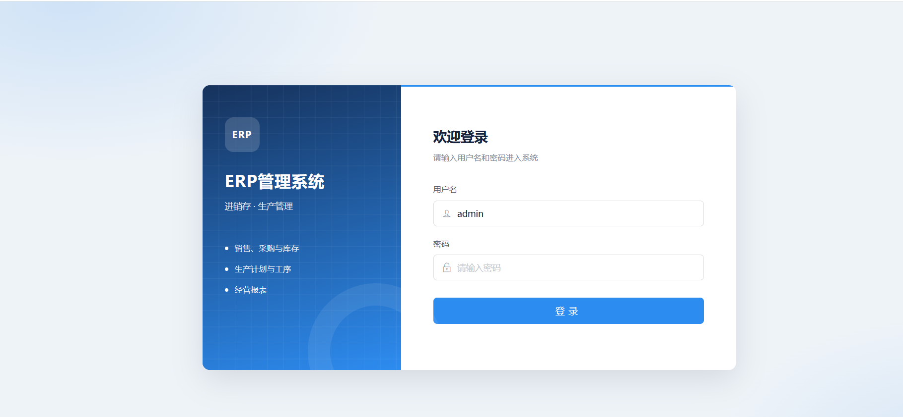
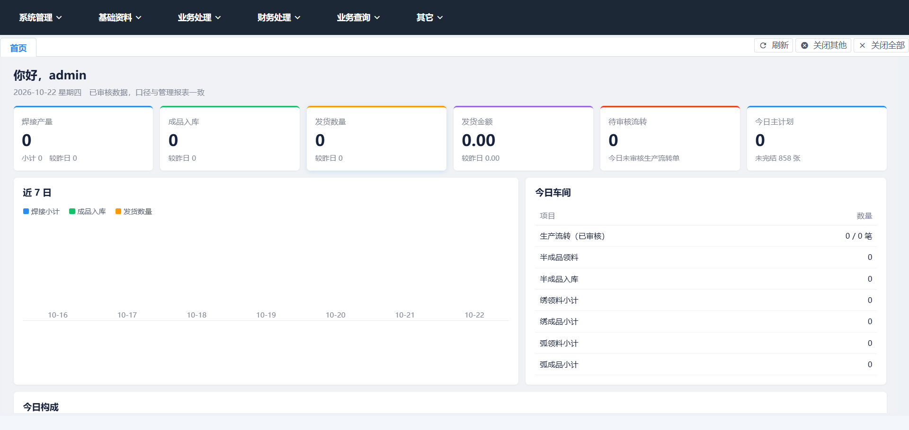
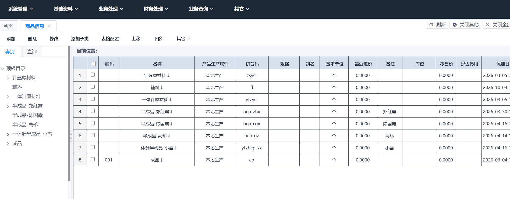
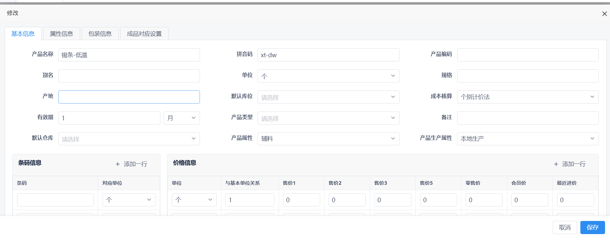
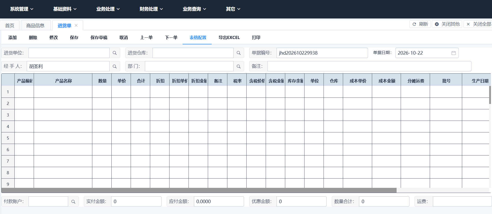
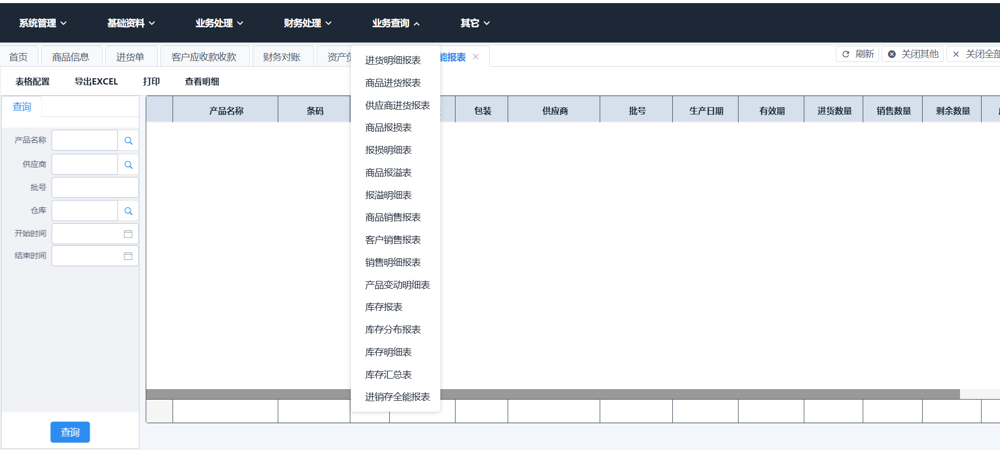

# SMQWX ERP 管理系统

> 面向五金制品制造业的**进销存 + 生产管理**一体化系统。
> ASP.NET MVC 5 ( .NET Framework 4.8 ) 单体应用,SQL Server 存储,`SqlSugar` 轻量 ORM。

系统把**基础资料 → 采购 → 销售 → 生产计划 → 工序流转 → 完工入库 → 财务结算 → 经营报表**串成一条完整链路,
并配套 Windows 桌面客户端、POS 零售收银和微信小程序端。

| | |
|---|---|
| **Web 端** | `SMQWX/` — 主站点,Area 划分业务域 |
| **业务逻辑** | `JXC.BLL/` — 单据、报表、菜单、权限 |
| **数据访问** | `JXC.DAL/` — `DbService` + 实体模型 |
| **公共库** | `JXC.Web/` — jqGrid 封装、Excel、Redis、验证码等工具 |
| **零售端** | `JXC.Retail/` — WinForms POS 收银 |
| **桌面壳** | `win_jxc/` — CefSharp / WebView2 内嵌 Web |
| **客户端组件** | `伺服器/` — Delphi 编写的客户端通讯与业务组件 |
| **数据库升级** | `升级脚本/` — 每次改动的 `.sql` 脚本 |
| **开发约定** | [`开发.md`](开发.md) — 库表口径的权威说明,改代码前必读 |

---

## 目录

- [界面预览](#界面预览)
- [技术栈](#技术栈)
- [功能模块](#功能模块)
- [单据类型](#单据类型)
- [数据库](#数据库)
- [本地运行](#本地运行)

---

## 界面预览

### 登录

### 工作台首页

登录后进入工作台,顶部汇总焊接产量、成品入库、发货数量/金额、待审核流转、今日主计划六个指标卡,并带近 7 日趋势图。

### 功能菜单

顶部六大菜单由数据库 `menu` 表驱动,配合角色权限动态下发。

### 基础资料 — 商品信息

按分类树维护产品,支持产品生产属性、拼音码、规格颜色、默认库位、一品多码等;`products.ismeterial` 区分原材料 0 / 半成品 1 / 成品 2 / 辅料 3 / 劳务 4。

### 业务处理 — 销售单 / 进货单

单据页统一提供添加、删除、修改、保存、保存草稿、上一单、下一单、表格配置、导出 EXCEL、打印。明细行支持**批号、生产日期、有效期**,录入过程自动暂存在浏览器 IndexedDB,关页不丢单。

| 销售单 | 进货单 |
|---|---|
|  |

### 业务查询 — 进销存全能报表 / 库存报表

按**批次**维度的进销存全量台账:产品、规格、包装、供应商、批号、生产日期、有效期,以及进货量、销售量、剩余量。剩余量始终取当前库存,日期只过滤发生额。

| 进销存全能报表 | 库存报表 |
|---|---|
|  |

### 生产报表 — 焊接生产日报

按天汇总焊接产量、3P、留作 3P、用针丝量、领针丝量、一体针、纹身针,口径与半成品入库报表一致。

### 财务处理 — 资产负债表

标准三段式资产负债表,支持自定义起止日期区间查询与导出。

### 系统管理 — 角色和权限管理

左侧角色列表(管理组 / 主管组 / 仓管员 / 普工),右侧按菜单树授权子功能与报表列。

### 其它 — 单据管理

集中查询全部业务单据,左侧按 30+ 种单据类型筛选。

---

## 技术栈

| 层次 | 技术选型 |
| --- | --- |
| Web 框架 | ASP.NET MVC 5 / Razor 3 / .NET Framework 4.8 |
| 视图引擎 | ASP.NET WebPages 3.2.7 + 自定义 Layout |
| ORM | SqlSugar 5.1.4.207(Code First 实体 + 存储过程) |
| 数据库 | SQL Server(SQLEXPRESS 实例) |
| 前端 | jQuery 3.4.1、View UI / iview 4.x、jqGrid、LayuiAdmin、layer、Vant(移动端) |
| 报表 | jqGrid 多表头 + `tj_*` 存储过程 + Stimulsoft 打印引擎 |
| 缓存 | StackExchange.Redis |
| 序列化 | Newtonsoft.Json 13 / LitJson 0.19 |
| 桌面客户端 | WinForms + CefSharp 143 / Microsoft.Web.WebView2 |
| 移动端 | `Areas/wxMobile` — 微信小程序(领料、退料、审核、拣货) |
| POS 零售 | `JXC.Retail` — WinForms 收银机,支持热键与票据打印 |

---

## 功能模块

### Web 端六大菜单

菜单定义在数据库 `menu` 表,`menu_type` 区分目录(`m`)与功能项,由 `get_user_menu_privillige` 按角色下发。

| 菜单 | 功能项 |
| --- | --- |
| **系统管理** | 系统设置、角色和权限管理、打印设置、价格跟踪查询、会员管理、门店管理、会员卡类型管理 |
| **基础资料** | 商品信息、客户信息、供应商信息、员工信息、仓库信息、部门信息、收款账户、基础信息(库位/产品类型/成本核算办法)、费用项目、其它收入项目、报表项目 |
| **业务处理** | 进货订单、进货单、进货退货单、销售订单、销售单、销售退货单、库存报损单、库存报溢单、调拨单、盘点单、成本调价单 |
| **财务处理** | 客户应收款收款、供应商应付款付款、财务对账、往来应收应付、往来明细、费用单、其它收入单、资产负债表、财务明细、利润表 |
| **业务查询** | 进货明细报表、商品进货报表、供应商进货报表、商品报损表、报损明细表、商品报溢表、报溢明细表、商品销售报表、客户销售报表、销售明细报表、产品变动明细表、库存报表、库存分布报表、库存明细表、库存汇总表、进销存全能报表 |
| **其它** | 单据管理、草稿管理、产品效期报警设置、效期报警报表 |

### 生产管理(报表层)

`Areas/Reportoperation/procedurerpt` 下 30+ 个生产报表,覆盖生产计划的全部产品线口径:

- **焊接生产日报** — 焊接产量、3P、留作 3P、用针丝量、领针丝量
- **成品生产发货日报** — 成品数量、单针、发货数量 / 筋条 / 单针 / 针丝
- **绣 / 弧** 每日领明细、每日成品明细、正负日报表(主单分布)
- **纹身针日报表** — 单据数量、成品交三楼、正负、发货接杆
- **一体针** 发货明细、每日出入发货明细
- **成品库存日报表** — 按天结存,含成品库存、锡条、锡丝、裸筋 / 弧筋 / 绣筋
- **原材料 / 辅料领料统计** — 按员工、产品、仓库汇总

`Areas/ProcedureOperation` 提供生产计划(主计划 / 子计划)、工序路径与工序审核、领料查询。

### 移动端(`Areas/wxMobile`)

微信小程序端覆盖半成品领退料、原辅料领退料、审核、拣货、计件统计等车间场景。

---

## 单据类型

`JXC.BLL.tradeoperation.billtypes` 统一定义 25 种单据,单据表头 `billidx.billtype` 与库存流水 `product_detail.optype` 共用这套编号。

| 编号 | 单据 | 编号 | 单据 |
| --- | --- | --- | --- |
| 1 | 销售单 | 20 | 客户应收款收款单 |
| 2 | 销售退货单 | 21 | 供应商应付款付款单 |
| 3 | 进货单 | 30 | 库存报损单 |
| 4 | 进货退货单 | 31 | 库存报溢单 |
| 5 | 销售订单 | 32 | 调拨单 |
| 6 | 进货订单 | 33 | 盘点单 |
| 7 | 原材料领料单 | 34 | 成品转半成品领料单 |
| 8 | 半成品领料单 | 35 | 原辅料领料单 |
| 9 | 半成品入库单 | 36 | 原辅料退料单 |
| 10 | 生产流转单 | 37 | 成本调价单 |
| 11 | 成品入库单 | 38 | 零售单 |
| 12 | 半成品转成品单 | 39 | 零售退货单 |
| 13 | 原材料退料单 | | |
| 14 | 半成品退料单 | | |

---

## 数据库

**SQL Server / 数据库 `jxc`**,当前规模:77 张表、29 个视图、70 个存储过程、3 个触发器。

---

## 本地运行

### 1. 数据库

- 实例:**SQL Server Express**(`.\sqlexpress`),数据库名 **`jxc`**
- 连接字符串在 `SMQWX/Web.config` → `connectionStrings` → `JXC`

### 2. Web 端

1. Visual Studio 2019/2022 打开 **`JXC.sln`**(VS 17.x,目标框架 .NET Framework 4.8)
2. 还原 NuGet 包 —— `packages/` 目录已随仓库提供,离线也能编译
3. 把 `SMQWX` 设为启动项目,IIS Express 端口默认 `63265`
4. 浏览器打开 <http://localhost:63265/Login/Index>

**默认账号:`admin` / `123456`**(管理员角色,权限最全)

### 3. 桌面端与零售端

| 项目 | 说明 |
| --- | --- |
| `JXC.Retail` | POS 零售收银 WinForms,需先启动 Web 服务 |
| `win_jxc` | 桌面壳,通过 CefSharp / WebView2 内嵌 Web 端 |
| `伺服器` | Delphi 编写的客户端通讯与业务组件,独立工具链 |

---

## 许可

内部项目,版权归使用者所有。
